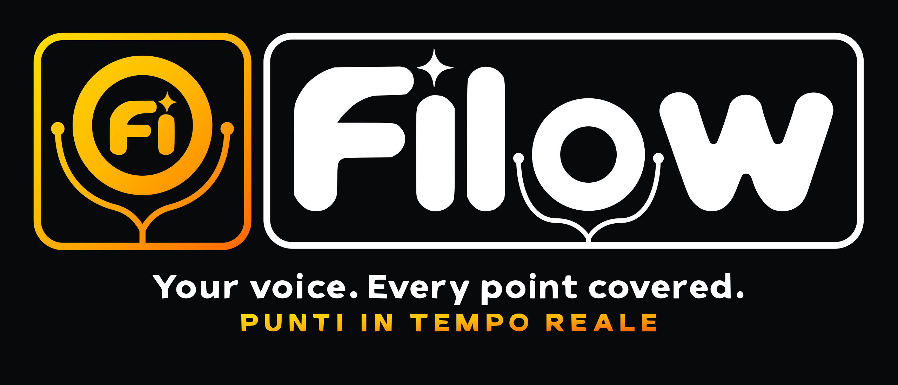

<p align="right"><a href="README.md">English</a> · <strong>Italiano</strong></p>
<p align="center">
  <picture>
    <source media="(prefers-color-scheme: light)" srcset="brand/png/filow-primary-light.png" />
    
  </picture>
</p>

<p align="center"><strong>Parla liberamente. Resta sul punto.</strong><br/>
Filow è un compagno di parola dal vivo: ti ascolta mentre presenti, spunta i tuoi punti man mano che li tratti e ti mostra quelli che hai saltato. Non è un teleprompter che scorre.</p>

<p align="center">
  <a href="https://github.com/stefandsl/filow/releases/latest"></a>
  <a href=".github/workflows/desktop.yml"></a>
  
  
  
  
  <a href="LICENSE"></a>
</p>

<p align="center"><sub>Software libero, © 2026 Stefan Butnaru (VoidExploit), rilasciato sotto <a href="LICENSE">GNU General Public License v3.0 o successiva</a>. Gli installer precedenti alla v0.9.18 mostrano ancora il testo proprietario (o, fino alla v0.6.0, MIT) nella pagina della licenza; dalla v0.9.18 l'installer riporta l'avviso GPL.</sub></p>

<p align="center">
  <a href="https://github.com/stefandsl/filow/releases/latest">Download</a> ·
  <a href="#come-funziona">Come funziona</a> ·
  <a href="#screen-sense">Screen Sense</a> ·
  <a href="#mirror-sul-telefono-e-controllo-remoto">Mirror sul telefono</a> ·
  <a href="#add-in-per-powerpoint">PowerPoint</a> ·
  <a href="#modalità-locale-privacy">Privacy</a> ·
  <a href="ARCHITECTURE.md">Architettura</a>
</p>

---

> **Rinominato da Intelliprompter nella 0.8.0.** Le installazioni esistenti continuano a funzionare: al primo avvio l'app sposta il proprio profilo (chiavi, script, certificati, file dell'add-in) nella nuova cartella, accetta i vecchi nomi di variabile `INTELLIPROMPTER_*`, si aggiorna sopra la vecchia installazione e registra di nuovo l'add-in per PowerPoint. I vecchi URL GitHub reindirizzano ai nuovi. Su un server Debian rinomina le unità systemd quando preferisci (vedi la sezione sul deploy); i vecchi nomi delle unità continuano a funzionare.

## Il problema: con un copione sembri uno che legge

Un teleprompter classico fa scorrere il testo a velocità fissa e tu lo insegui. Nel momento in cui improvvisi, racconti un aneddoto o rispondi a una domanda, tu e il prompter vi perdete, e il resto dell'intervento lo passi a cercare il segno. L'alternativa, i punti elenco su un foglietto, ti lascia naturale ma non ti dà alcun riscontro: il punto che hai saltato lo scopri solo a intervento finito.

Filow tiene i punti elenco e aggiunge il riscontro. Ascolta e, due volte al secondo, un piccolo modello risponde a una sola domanda per ogni punto aperto: *chi parla ha iniziato a trattare questo argomento?* Parafrasi, esempi e traduzioni contano; "ci arrivo dopo" no. I punti passano a **iniziato** man mano che li tratti, e quelli che salti si accumulano in un vassoio **Saltati**, così puoi tornarci prima di concludere.

## Cosa fa

Il prompter usa superfici opache e un'unica disposizione con barra laterale sinistra nei temi scuro e chiaro, con gli stessi controlli. Il pulsante del tema passa da chiaro a scuro a sistema; icona ed etichetta accessibile indicano la scelta attuale. Sistema segue i colori del sistema operativo senza spostare i controlli. Abbina dispositivo apre i controlli del mirror anche quando il relay non è disponibile. I selettori mostrano etichette brevi con descrizioni complete nei suggerimenti. I punti mostrano In attesa, In corso o Detto con icona, testo e barra di avanzamento; i punti completati sono barrati e mostrano una spunta verde. Importa e Ricarica si trovano nella barra laterale, Modifica punti sotto il titolo e Avvia/Ferma nella barra inferiore. Altro contiene Azzera e Registro e segnalazione. Espandi Questo computer per risorse e diagnostica dei modelli. La trascrizione si espande sotto i punti, con il comando nella barra inferiore. Il mirror sul telefono mantiene la propria disposizione.

La scheda Prossima sezione sotto i punti ha una maniglia sul bordo inferiore. Trascinala oppure selezionala con la tastiera e usa Freccia su/Freccia giù a passi di 16 px; il doppio clic ripristina 240 px. L'altezza resta tra 120 px e il 70 percento dell'area contenuti (120 px ha la precedenza nelle aree molto basse). Il contenuto lungo scorre dentro la scheda. Ogni visualizzatore salva la propria altezza in `prefs:nextHeight`; ridimensionare la finestra adatta la preferenza allo spazio disponibile e la ripristina quando lo spazio aumenta.

Nel prompter e nel mirror con controllo, Tab seleziona i punti e gli elementi saltati. Premi Invio o Spazio per cambiare lo stato di un punto o riaprire un elemento saltato. Il doppio clic su un punto continua a funzionare.

Con zoom elevato o una finestra bassa, la pagina scorre per mantenere punti e comandi raggiungibili. Le finestre di avvio, scelta della sorgente e modifica del copione mantengono il focus della tastiera al loro interno; Esc le chiude e riporta il focus al comando di apertura. Chiudere il registro riporta il focus ad Altro. Annulla interrompe anche le verifiche automatiche di avvio ancora in corso. Gli errori di importazione compaiono subito sopra i punti e vengono annunciati dal lettore di schermo.

| | |
|---|---|
| ✅ **Spunta dal vivo** | I punti vengono spuntati man mano che li tratti, giudicati per idea, non per parole. Confidenza mostrata per ogni punto. |
| ⚠️ **Vassoio Saltati** | Tutto quello che hai scavalcato, un clic per riaprirlo. |
| 👁 **Screen Sense** | Osserva le tue slide o qualsiasi finestra e ti dice cosa c'è sullo schermo, quali fatti non hai ancora detto e quando una slide contraddice il tuo script. |
| 📱 **Mirror sul telefono** | Inquadra un QR e il telefono mostra la vista dal vivo con Prec / Succ / Stop. Funziona da qualsiasi rete per impostazione predefinita; approvi ogni telefono. |
| 🖥 **Add-in per PowerPoint** | Un clic aggiunge Filow a PowerPoint su questo PC o Mac. Le note del relatore diventano lo script, oppure lo script viene generato dalle slide. |
| 🧩 **Estensione per il browser** | reveal.js, Slidev, Marp, Canva, Pitch: genera lo script dal deck e segue la slide dal vivo. |
| 📄 **Importazione** | PDF, PPTX, DOCX, TXT o Markdown diventano punti, una sezione per slide o pagina. |
| 🔒 **Modalità privacy** | Whisper sul dispositivo, un modello di decisione locale tramite Ollama, un filtro PII prima di ogni chiamata cloud e una modalità offline completa. |
| 🌍 **Interfaccia in inglese e italiano** | Automatico / English / Italiano; finestre e menu desktop condividono la preferenza, i browser hanno la propria. |
| 🌗 **Tema chiaro e scuro** | Interruttore ☀ / ◐ / ☾; "sistema" segue Windows o macOS. |
| 🔄 **Aggiornamento automatico** | L'app desktop controlla GitHub e installa da sola le nuove versioni. |

## Finestra di benvenuto

L'app desktop apre **Benvenuto** prima di caricare l'app principale o proporre la configurazione
dell'AI locale. Scegli Automatico (lingua del sistema, italiano oppure inglese come ripiego), English
o Italiano; il tema di sistema è attivo e il colore principale di sistema è disattivato per
impostazione predefinita. Disattivando il tema di sistema si mantiene l'aspetto corrente e compaiono
le scelte Chiaro/Scuro. Il colore di sistema usa testo a contrasto; disattivandolo torna il giallo
Filow. Le modifiche sono immediate in tutte le finestre desktop e indipendenti dalla lingua parlata.
Le preferenze di browser e telefono rimangono separate.

**Inizia** o la X della finestra salva il completamento una volta per profilo. Riapri tutte e quattro
le opzioni da **Filow > Benvenuto...** senza interrompere la registrazione. L'avvio automatico è
disponibile nelle versioni installate Windows/macOS, non si attiva da solo e riflette le impostazioni
del sistema; macOS può richiedere l'approvazione negli elementi di login. L'opzione è nascosta nelle
versioni di sviluppo, in Windows portable e su Linux; Linux nasconde anche il colore di sistema.
Avvio automatico e colore su macOS richiedono ancora una verifica su un dispositivo reale.

Per test isolati dai sorgenti, imposta `FILOW_USER_DATA_DIR` su un percorso assoluto, ad esempio
`G:\FILOW\tmp\welcome-qa`: userData e sessionData di Electron usano entrambi questa cartella, senza
importare il vecchio profilo. Imposta anche TEMP/TMP e le cache degli strumenti nella cartella QA.
Esegui `npm run build` e `npm run build:welcome -w apps/desktop`, poi `npx electron .` in
`apps/desktop`. `npm run start -w apps/desktop` ricompila automaticamente Benvenuto. Il flag è
`welcomeCompleted` in `settings.json` del profilo; se assente o falso, Benvenuto compare.

## Avvio rapido

Scegli **Microfono** nelle Impostazioni accanto alla lingua parlata, oppure nella barra della
sessione. Consenti il microfono una volta per vedere i nomi. Predefinito di sistema è la prima
opzione; se il dispositivo salvato non è disponibile viene usato il predefinito e il log lo segnala.
Le modifiche durante una sessione si applicano al prossimo avvio. Web Speech usa sempre il predefinito.
Quattro secondi di silenzio digitale o la fine della traccia mostrano un avviso con il pulsante
per scegliere un microfono, senza fermare la sessione. L'avviso scompare quando arriva audio.
Anche un'apertura audio oltre cinque secondi viene segnalata con il tempo misurato.
Il download del modello in streaming si interrompe dopo 30 secondi senza dati, elimina gli
archivi parziali e riprova tre volte dopo 5, 15 e 45 secondi. L'errore finale appare nelle
Impostazioni e in startup.log.

1. **Scarica** l'installer per il tuo sistema dall'[ultima release](https://github.com/stefandsl/filow/releases/latest) (`-win-x64.exe`, `-mac-arm64.dmg` / `-mac-x64.dmg`, `-linux-x86_64.AppImage` / `.deb`). Windows mostra un avviso SmartScreen perché la build non è ancora firmata; vedi [Firma del codice](#firma-del-codice-e-lavviso-smartscreen).
2. **Aggiungi la tua chiave**: menu → *Edit API keys (.env)* → incolla una chiave [OpenRouter](https://openrouter.ai/keys) (pochi centesimi a intervento) → riavvia.
3. **Scrivi i punti**: *Modifica punti*, oppure *Importa documento*, oppure semplicemente *Osserva schermo…* e lascia che Screen Sense costruisca una sezione per slide.
4. **Avvia**, parla, guarda i punti spuntarsi da soli. Clicca sul codice di abbinamento per avere la stessa vista sul telefono.

## Perché è diverso

- **Giudica le idee, non le parole chiave.** Il modello di decisione riceve i punti aperti, i punti già trattati, la sezione successiva e cosa c'è sullo schermo, e deve preferire un falso "non iniziato" a una spunta sbagliata. Due risposte sicure di fila, o una molto sicura, fanno scattare un punto.
- **Un motore, molte viste.** Il portatile gestisce il microfono e le decisioni; il telefono, il riquadro di PowerPoint e qualsiasi browser sono viste della stessa sessione attraverso un piccolo relay. Sul telefono non si installa nulla.
- **I tuoi dati restano tuoi per impostazione predefinita.** I fotogrammi di Screen Sense vivono in memoria e vanno una sola volta al modello di visione; i dati personali sono sostituiti da segnaposto prima di ogni chiamata cloud; voce e decisioni possono girare interamente sulla tua macchina; la modalità offline blocca ogni richiesta in uscita.
- **Nessun account, nessun server richiesto.** Tutto gira dentro l'app desktop, compreso il relay e, per l'abbinamento da altre reti, un quick tunnel gratuito di Cloudflare. Un deploy su Debian è disponibile quando vuoi un indirizzo permanente.

---

## Indice

1. [Come funziona](#come-funziona)
2. [Le chiavi API che ti servono](#le-chiavi-api-che-ti-servono)
3. [App desktop: installazione e avvio](#app-desktop-installazione-e-avvio)
4. [Eseguire dal sorgente su qualsiasi macchina (Windows, macOS, Linux)](#eseguire-dal-sorgente-su-qualsiasi-macchina)
5. [Compilare gli installer desktop da solo](#compilare-gli-installer-desktop-da-solo)
6. [Aggiornamenti automatici](#aggiornamenti-automatici)
7. [Firma del codice e l'avviso SmartScreen](#firma-del-codice-e-lavviso-smartscreen)
8. [Deploy su un server Debian](#deploy-su-un-server-debian)
9. [Sviluppare su un server Debian](#sviluppare-su-un-server-debian)
10. [Modalità locale (privacy)](#modalità-locale-privacy)
11. [Screen Sense](#screen-sense)
12. [Add-in per PowerPoint](#add-in-per-powerpoint)
13. [Formato dello script](#formato-dello-script)
14. [Struttura del progetto](#struttura-del-progetto)
15. [Risoluzione dei problemi](#risoluzione-dei-problemi)

---

## Come funziona

```
mic ──► transcription backend ──► rolling transcript
                                       │ every 500 ms (if it changed)
                                       ▼
                      POST /api/decide { transcript, open points }
                                       │
                                       ▼
                 OpenRouter chat completion, JSON out:
                 { decisions: [{ id, started, confidence }] }
                                       │
                                       ▼
          point flips to STARTED when started && confidence ≥ 0.7
```

Backend di trascrizione (scegli nel menu a tendina, o lascia su **Auto**):

| Backend | Richiede | Funziona in |
|---|---|---|
| Browser (Web Speech) | niente, gratuito | solo modalità **web** in Chrome / Edge. Non disponibile nell'app desktop. |
| ElevenLabs Scribe v2 Realtime | `ELEVENLABS_API_KEY` | ovunque. Come nella demo originale. |
| OpenAI gpt-live-transcribe | `OPENAI_API_KEY` | ovunque. |

**Auto** prova ElevenLabs, poi OpenAI, poi il browser, poi Whisper sul dispositivo. Un backend che dà errore o non produce parole entro 8 s viene saltato. Il log in basso mostra ogni tentativo e il tempo fino alle prime parole, così vedi quale è davvero il più veloce per te.

Le chiavi API non arrivano mai al browser: il server emette token a breve scadenza per i backend in streaming e chiama OpenRouter da sé.

### Presentare con PowerPoint (app desktop)

PowerPoint nasconde i riquadri attività durante una presentazione e la sua API per gli add-in non vede la presentazione, quindi l'app desktop fa due cose per conto proprio:

- **Segue la presentazione.** Su Windows l'app chiede a PowerPoint via COM (il canale usato dalla Visualizzazione Relatore) quale slide è sullo schermo, ogni 0,4 s; su macOS lo stesso tramite AppleScript. Quando la presentazione parte, la sezione corrente salta alla slide e continua a seguirla; nella barra in alto compare un chip "📽 slide n/m". Lo script deve venire dalle slide (note del relatore o **Genera script dalle slide** nel riquadro) perché i numeri di slide e di sezione coincidano.
- **Mostra un overlay per il relatore.** Una piccola finestra sempre in primo piano con il titolo della slide e i suoi punti, spuntati man mano che li dici, più il titolo della slide successiva. Si apre da sola quando parte una presentazione e si chiude quando finisce (menu: *Overlay relatore*, *Apri l'overlay automaticamente*). Trascinala dove vuoi, di solito sullo schermo del portatile accanto alla Visualizzazione Relatore; *Nascondi l'overlay da registrazioni e condivisioni dello schermo* la tiene fuori da Teams o OBS. L'overlay è una vista compatta della sessione dell'app stessa, quindi ciò che vedi lì è esattamente ciò che vede il telefono.

Linux non ha PowerPoint; lì il mirror sul telefono è la vista dal vivo.

### Mirror sul telefono e controllo remoto

Il motore (il browser o l'app desktop con il microfono) crea una **sessione** sul relay di sessione e mostra un codice a 6 cifre nella barra in alto. Cliccalo per avere un QR. Un telefono apre la pagina del mirror, inserisce il codice (o inquadra il QR) e ottiene la vista dal vivo con caratteri grandi più i pulsanti Prec / Succ / Reset / Avvia / Stop. Il mirror è una pagina web, quindi niente da installare; su Android o iOS usa "Aggiungi alla schermata Home" per un'app a schermo intero.

Come è protetto l'abbinamento: un codice funziona **una sola volta** e per **5 minuti** (la finestra mostra il conto alla rovescia e un pulsante Nuovo codice; un secondo telefono ha bisogno di un nuovo codice). Un telefono che si abbina tramite il link pubblico resta **in attesa** finché non lo accetti: l'app mostra il dispositivo ("iPhone · Safari") con Consenti / Solo vista / Rifiuta, e fino ad allora il telefono non vede nulla. I telefoni sulla stessa Wi-Fi dell'app desktop entrano senza richiesta. I tentativi di abbinamento sono limitati per indirizzo e globalmente, e la pagina del telefono non si connette mai a un server diverso dal proprio senza chiedertelo.

- Modalità web: il relay è `apps/server` sulla porta 4748, avviato da `npm run dev` insieme all'app web.
- App desktop: il relay gira dentro l'app. Il QR contiene l'indirizzo LAN del tuo portatile. Il primo avvio provoca una richiesta del firewall di Windows.
- Server ospitato: vedi la sezione Debian; imposta `ACCESS_PASSWORD` così gli estranei non spendono i tuoi crediti.

#### Telefono su un'altra rete

Un telefono in rete mobile, o su una Wi-Fi aziendale che isola i client, non può raggiungere l'indirizzo del tuo portatile. Tre strade, in ordine di impegno:

1. **Link pubblico, attivo per impostazione predefinita** nell'app desktop. Al primo avvio l'app scarica una sola volta il `cloudflared` gratuito di Cloudflare (circa 20 MB, mostrato come "Configurazione del link pubblico…" nella finestra di abbinamento), apre due quick tunnel e aggiorna il QR; da quel momento contiene URL casuali `https://….trycloudflare.com` che funzionano ovunque, come WhatsApp Web. La finestra di abbinamento dice "Funziona da qualsiasi rete" quando è pronto, oppure perché non lo è (niente internet, download bloccato), nel qual caso il QR continua a funzionare sulla stessa Wi-Fi. Disattivalo nella finestra ("Torna a solo Wi-Fi"), con la ✕ sul chip "link pubblico" nella barra in alto, o dal menu; il tunnel si ferma anche quando l'app si chiude. I quick tunnel (`*.trycloudflare.com`) sono pensati per prove brevi: nessuna garanzia di disponibilità, un nuovo URL a ogni avvio. Per gli interventi che contano, usa un tuo server (sotto) o un [tunnel Cloudflare con nome](https://developers.cloudflare.com/cloudflare-one/connections/connect-networks/) con Cloudflare Access davanti alla pagina del mirror. L'abbinamento richiede comunque il codice a 6 cifre, è limitato nella frequenza, e gli endpoint che spendono restano dietro il token del motore. Disattivalo dallo stesso menu; gli URL cambiano ogni volta. Non disponibile in modalità Offline.
2. **Stessa VPN su entrambi**: se il portatile e il telefono usano la stessa VPN (Tailscale, Twingate…), scegli l'indirizzo VPN nel menu **Indirizzo del mirror su questa rete** e inquadra di nuovo. L'app preferisce per impostazione predefinita un indirizzo LAN privato, quindi un indirizzo VPN non viene mai scelto automaticamente.
3. **Un tuo server**: fai il deploy con la configurazione Debian qui sotto e punta l'app desktop verso di esso con `FILOW_SESSION_URL` in `.env`. URL permanente, dominio tuo.

Se il QR mostra un indirizzo che il telefono non riesce ad aprire, controlla il menu **Indirizzo del mirror su questa rete**: il portatile può averne diversi (Wi-Fi, Ethernet, VPN, schede virtuali) e la scelta automatica può essere sbagliata.

---

## Le chiavi API che ti servono

| Chiave | Obbligatoria? | Dove ottenerla |
|---|---|---|
| `OPENROUTER_API_KEY` | **Sì** | https://openrouter.ai/keys |
| `ELEVENLABS_API_KEY` | App desktop: una di queste due. Web: facoltativa. | https://elevenlabs.io/app/settings/api-keys |
| `OPENAI_API_KEY` | App desktop: una di queste due. Web: facoltativa. | https://platform.openai.com/api-keys |
| `OPENROUTER_DECISION_MODEL` | No (predefinito `google/gemini-2.5-flash-lite`) | qualsiasi id di modello da https://openrouter.ai/models |

Per il modello di decisione, più economico e veloce è meglio: viene chiamato due volte al secondo.

---

## App desktop: installazione e avvio

Scarica il file per il tuo sistema dalla pagina **Releases** di questo repository (compilato automaticamente da GitHub Actions; vedi [Compilare gli installer desktop da solo](#compilare-gli-installer-desktop-da-solo) se non c'è ancora una release).

| Sistema | File | Note |
|---|---|---|
| Windows | `Filow-x.y.z-win-x64.exe` (l'installer NSIS; la build portable ha lo stesso schema di nome) | Non firmato: SmartScreen mostra "autore sconosciuto". Clicca **Ulteriori informazioni → Esegui comunque**. |
| macOS | `Filow-x.y.z-mac-arm64.dmg` (Apple Silicon) o `-mac-x64.dmg` (Intel) | Non firmato: il primo avvio è bloccato. Esegui una volta nel Terminale: `xattr -dr com.apple.quarantine /Applications/Filow.app` |
| Linux | `Filow-x.y.z-linux-x64.AppImage` o `.deb` | AppImage: `chmod +x` poi esegui. Deb: `sudo apt install ./filow_x.y.z_amd64.deb` |

### L'installer per Windows

Una procedura guidata passo per passo nella lingua del tuo Windows (inglese, italiano, tedesco, francese, spagnolo, portoghese, olandese, polacco, russo, giapponese, cinese; le pagine personalizzate sono in inglese e italiano): benvenuto, licenza (proprietaria, © VoidExploit), cartella di installazione, una pagina **AI in locale su questo PC** (vedi sotto), poi la pagina finale con **Esegui Filow** e **Crea un collegamento sul desktop**. L'app si apre con una schermata iniziale (logo, barra di avanzamento, "Modelli locali · i dati restano su questo PC · GDPR" quando gira in locale, "Filtro PII attivo · GDPR" altrimenti) mentre i server e il link pubblico partono, poi va alle Impostazioni per scaricare i modelli che hai spuntato.

#### AI locale scelta in base all'hardware

L'installer esegue una scansione rapida (RAM, nome della GPU, spazio libero sul disco del profilo) e preseleziona i modelli che girano bene su quella macchina; la pagina mostra il risultato della scansione e lascia spuntare o togliere qualsiasi voce, quindi nulla è imposto:

| Questo PC | Preselezionati |
|---|---|
| 32 GB di RAM o più | Whisper small, Clef Flash (decisioni in locale), Gemma 4 E4B (copione dalle slide) |
| 16 GB | Whisper small con una vera GPU (NVIDIA, Radeon, Arc, Iris Xe) altrimenti Whisper base, Clef Flash, Gemma 4 E2B |
| 8 GB | Whisper base, Gemma 4 E2B |
| meno | Whisper base |

I modelli Ollama più grandi vengono tolti se il disco resterebbe con meno di 3 GB liberi. **Installa Ollama in background** è spuntato ogni volta che lo è un modello Clef o Gemma: al primo avvio l'app scarica l'installer ufficiale di Ollama (circa 1 GB), lo esegue in silenzio, lo avvia e poi scarica i modelli scelti mentre usi l'app. La pagina Impostazioni mostra ogni passo (download di Ollama 42 % → installazione → avvio → pronto → download dei modelli) e ha lo stesso pulsante **Installa Ollama automaticamente** per dopo. Su macOS e Linux, o con la versione portable, l'app pone la stessa domanda in una finestra al primo avvio (macOS: Ollama.app viene estratta in `~/Applications`; Linux: viene mostrato lo script ufficiale di una riga, perché richiede sudo).

### Primo avvio

1. Avvia l'app. Mostra un avviso che nessuna chiave OpenRouter è impostata.
2. Menu **Filow → Apri la cartella di configurazione**. Trovi una cartella con due file:
   - `.env` – incolla qui le tue chiavi (stesso formato di `.env.example`)
   - `script.md` – i tuoi punti (modificabili anche da **Modifica punti** dentro l'app)
3. Salva `.env`, chiudi e riavvia l'app.
4. Premi **Avvia**, consenti il microfono, parla.

Posizione della cartella di configurazione:

| Sistema | Percorso |
|---|---|
| Windows | `%APPDATA%\Filow\` |
| macOS | `~/Library/Application Support/Filow/` |
| Linux | `~/.config/Filow/` |

L'app desktop non ha il backend Web Speech (il Chromium di Electron ne è privo), quindi imposta `ELEVENLABS_API_KEY` o `OPENAI_API_KEY`.

---

## Eseguire dal sorgente su qualsiasi macchina

Prerequisiti: **Node.js 22** (https://nodejs.org) e **git**. Chrome o Edge se vuoi la trascrizione gratuita del browser.

### Windows (PowerShell)

```powershell
git clone https://github.com/<you>/filow.git
cd filow
npm ci
Copy-Item apps/web/.env.example apps/web/.env.local
notepad apps/web/.env.local      # paste your keys, save
npm run dev             # web app (4747) + session relay (4748), hot reload
```

Apri http://localhost:4747 in Chrome o Edge e consenti il microfono.

### macOS / Linux

```bash
git clone https://github.com/<you>/filow.git
cd filow
npm ci
cp apps/web/.env.example apps/web/.env.local
nano apps/web/.env.local         # paste your keys, save with Ctrl+O, Enter, Ctrl+X
npm run dev             # web app (4747) + session relay (4748)
```

Apri http://localhost:4747 in Chrome o Edge.

### Modalità produzione (più veloce, senza hot reload)

```bash
npm run build
npm start
```

### Eseguire l'app desktop dal sorgente (senza installer)

```bash
npm run desktop
```

---

## Compilare gli installer desktop da solo

### Opzione A: lascia che GitHub compili tutte e tre le piattaforme (consigliata)

Il push di un tag di versione compila gli installer per Windows, macOS e Linux e li allega a una Release GitHub:

```bash
git tag v0.1.0
git push origin v0.1.0
```

Oppure avvialo a mano: GitHub → **Actions → Desktop builds → Run workflow**. Gli installer compaiono come artefatti scaricabili nella pagina dell'esecuzione (e come Release quando l'avvio è dato da un tag).

Gli installer non sono firmati a meno che tu non aggiunga un certificato; vedi [Firma del codice](#firma-del-codice-e-lavviso-smartscreen).

### Opzione B: compila in locale

Puoi compilare solo per il sistema su cui ti trovi (le build macOS richiedono un Mac).

```bash
npm ci
npm run desktop:build:win      # on Windows  → release/*.exe
npm run desktop:build:mac      # on macOS    → release/*.dmg
npm run desktop:build:linux    # on Linux    → release/*.AppImage, release/*.deb
```

Il risultato finisce in `release/`.

---

## Aggiornamenti automatici

L'app desktop installata controlla se c'è una nuova versione pochi secondi dopo l'avvio e dal menu (*Controlla aggiornamenti…*). L'aggiornamento si scarica in background; ricevi "Riavvia ora / Più tardi", e un aggiornamento rimandato si installa da solo alla prossima chiusura. Windows e Linux (AppImage) si aggiornano sul posto; macOS richiede una build firmata e notarizzata per gli aggiornamenti sul posto, quindi su Mac l'app si limita a dirti che esiste una nuova versione finché quello non è configurato.

Il feed è un repository GitHub **pubblico** che contiene solo gli installer, perché questo repository sorgente è privato e un'app installata non può leggere release private senza portarsi dietro un segreto. Configurazione una tantum, da una macchina dove `gh` è autenticato:

```bash
gh repo create stefandsl/filow-releases --public --description "Filow installers (auto-update feed)"
```

Crea su GitHub un personal access token a grana fine (Settings → Developer settings → Personal access tokens) con **Contents: read and write** solo su `filow-releases`, poi salvalo come secret di questo repository:

```bash
gh secret set RELEASES_TOKEN --repo stefandsl/filow
```

Dal tag successivo in poi, il job di release pubblica gli stessi installer più i metadati di aggiornamento (`latest*.yml`, `*.blockmap`) nel repository pubblico, e le app installate li rilevano. Niente del sorgente esce dal repository privato.

## Firma del codice e l'avviso SmartScreen

Windows mostra "Microsoft Defender SmartScreen non è riuscito a verificare questo file" per qualsiasi installer non firmato e non ancora scaricato da molte persone. L'avviso non si elimina modificando l'installer; sparisce quando la build è firmata con un certificato di cui Windows si fida:

| Opzione | Costo | Reputazione SmartScreen | Note |
|---|---|---|---|
| **Azure Trusted Signing** | circa 10 €/mese | immediata | Richiede un account Azure e la verifica dell'identità (accettati anche i privati). Consigliata. |
| **Certificato di firma codice EV** | 300–500 €/anno | immediata | Token hardware o HSM in cloud; la CI ha bisogno di un servizio di firma. |
| **Certificato di firma codice OV** | 100–250 €/anno | si costruisce in settimane di download | Il più semplice da collegare: un file `.pfx`. |

Per un certificato `.pfx` il workflow è già pronto: salva il file e la sua password come secret del repository e ogni build con tag viene firmata.

```bash
base64 -w0 your-certificate.pfx | gh secret set WIN_CSC_LINK --repo stefandsl/filow
```

```bash
gh secret set WIN_CSC_KEY_PASSWORD --repo stefandsl/filow
```

Per Azure Trusted Signing, aggiungi in `apps/desktop/package.json` sotto `build.win` un blocco `azureSignOptions` con i tuoi `publisherName`, `endpoint`, `certificateProfileName` e `codeSigningAccountName`, e i secret `AZURE_TENANT_ID`, `AZURE_CLIENT_ID`, `AZURE_CLIENT_SECRET` come env del workflow; electron-builder firma con quelli. Imposta `build.win.publisherName` al nome esatto che compare sul certificato, così l'updater può verificare gli installer scaricati.

Su macOS l'equivalente è un certificato Apple Developer ID più la notarizzazione (`CSC_LINK`, `CSC_KEY_PASSWORD`, `APPLE_ID`, `APPLE_APP_SPECIFIC_PASSWORD`, `APPLE_TEAM_ID`) e la rimozione di `CSC_IDENTITY_AUTO_DISCOVERY: "false"` dal workflow.

---

## Deploy su un server Debian

Obiettivo: Debian 12 (bookworm), server appena installato, hai `sudo`. Il browser consente l'accesso al microfono solo su **HTTPS** (o `localhost`), quindi un server remoto deve essere servito via HTTPS. I comandi qui sotto usano **Caddy**, che ottiene automaticamente un certificato Let's Encrypt. Prima ti serve un record DNS `A` per il tuo dominio che punti al server.

Sostituisci ovunque `prompter.example.com` con il tuo dominio e `<you>` con il tuo utente GitHub.

### 1. Pacchetti di sistema e Node.js 22

```bash
sudo apt update && sudo apt -y upgrade
sudo apt -y install git curl ca-certificates gnupg ufw
curl -fsSL https://deb.nodesource.com/setup_22.x | sudo -E bash -
sudo apt -y install nodejs
node -v && npm -v
```

### 2. Un utente dedicato e il codice

```bash
sudo useradd -r -m -d /opt/filow -s /usr/sbin/nologin prompter
sudo -u prompter git clone https://github.com/<you>/filow.git /opt/filow/app
```

Repository privato? Crea su GitHub un personal access token a grana fine **in sola lettura** e clona con quello:

```bash
sudo -u prompter git clone https://<you>:<TOKEN>@github.com/<you>/filow.git /opt/filow/app
```

### 3. Chiavi e build

```bash
cd /opt/filow/app
sudo -u prompter cp apps/web/.env.example apps/web/.env.local
sudo -u prompter nano apps/web/.env.local        # paste keys, Ctrl+O, Enter, Ctrl+X
sudo -u prompter npm ci
sudo -u prompter npm run build
```

### 4. Servizio systemd (parte all'avvio, riparte in caso di crash)

```bash
sudo tee /etc/systemd/system/filow.service >/dev/null <<'EOF'
[Unit]
Description=Filow (Next.js)
After=network.target

[Service]
Type=simple
User=prompter
WorkingDirectory=/opt/filow/app
EnvironmentFile=/opt/filow/app/apps/web/.env.local
Environment=NODE_ENV=production
Environment=PORT=4747
Environment=HOSTNAME=127.0.0.1
ExecStart=/usr/bin/node apps/web/.next/standalone/apps/web/server.js
Restart=always
RestartSec=3

[Install]
WantedBy=multi-user.target
EOF
sudo tee /etc/systemd/system/filow-session.service >/dev/null <<'EOF'
[Unit]
Description=Filow session relay
After=network.target

[Service]
Type=simple
User=prompter
WorkingDirectory=/opt/filow/app
EnvironmentFile=/opt/filow/app/apps/web/.env.local
Environment=NODE_ENV=production
Environment=SESSION_PORT=4748
Environment=SESSION_HOST=127.0.0.1
Environment=TRUST_PROXY=1
ExecStart=/usr/bin/node apps/server/dist/bundle.js
Restart=always
RestartSec=3

[Install]
WantedBy=multi-user.target
EOF
sudo systemctl daemon-reload
sudo systemctl enable --now filow filow-session
sudo systemctl status filow filow-session --no-pager
curl -s http://127.0.0.1:4747/api/stt/status
curl -s http://127.0.0.1:4748/health
```

Imposta `ACCESS_PASSWORD=<qualcosa di lungo>` e `NEXT_PUBLIC_SESSION_URL=` (vuoto, cioè stessa origine) in `apps/web/.env.local` **prima** di `npm run build`: su un server pubblico la password è ciò che impedisce agli estranei di usare le tue chiavi API. L'app web la chiede una volta e la ricorda nel browser.

L'ultimo comando dovrebbe stampare qualcosa come `{"elevenlabs":true,"openai":false}`.

### 5. HTTPS con Caddy

```bash
sudo apt -y install debian-keyring debian-archive-keyring apt-transport-https
curl -1sLf 'https://dl.cloudsmith.io/public/caddy/stable/gpg.key' | sudo gpg --dearmor -o /usr/share/keyrings/caddy-stable-archive-keyring.gpg
curl -1sLf 'https://dl.cloudsmith.io/public/caddy/stable/debian.deb.txt' | sudo tee /etc/apt/sources.list.d/caddy-stable.list
sudo apt update && sudo apt -y install caddy
```

```bash
sudo tee /etc/caddy/Caddyfile >/dev/null <<'EOF'
prompter.example.com {
    handle /ws/* {
        reverse_proxy 127.0.0.1:4748
    }
    handle /api/session* {
        reverse_proxy 127.0.0.1:4748
    }
    handle {
        reverse_proxy 127.0.0.1:4747
    }
}
EOF
sudo systemctl reload caddy
```

### 6. Firewall

```bash
sudo ufw allow OpenSSH
sudo ufw allow 80/tcp
sudo ufw allow 443/tcp
sudo ufw --force enable
```

Apri `https://prompter.example.com` in Chrome o Edge, consenti il microfono, premi **Avvia**.

### Facoltativo: proteggere la pagina con password

Chiunque raggiunga l'URL può spendere i tuoi crediti API. Aggiungi la basic auth in Caddy:

```bash
caddy hash-password --plaintext 'choose-a-strong-password'
```

Copia l'hash stampato, poi:

```bash
sudo tee /etc/caddy/Caddyfile >/dev/null <<'EOF'
prompter.example.com {
    basicauth {
        stefan <PASTE_HASH_HERE>
    }
    handle /ws/* {
        reverse_proxy 127.0.0.1:4748
    }
    handle /api/session* {
        reverse_proxy 127.0.0.1:4748
    }
    handle {
        reverse_proxy 127.0.0.1:4747
    }
}
EOF
sudo systemctl reload caddy
```

### Aggiornare un server installato come Intelliprompter

I vecchi nomi delle unità, la cartella e `.env.local` continuano a funzionare (l'app legge sia i nomi `INTELLIPROMPTER_*` sia `FILOW_*`). Per allineare i nomi ai nuovi:

```bash
sudo systemctl disable --now intelliprompter intelliprompter-session
```

```bash
sudo mv /opt/intelliprompter /opt/filow && sudo mv /etc/systemd/system/intelliprompter.service /etc/systemd/system/filow.service && sudo mv /etc/systemd/system/intelliprompter-session.service /etc/systemd/system/filow-session.service
```

```bash
sudo sed -i 's#/opt/intelliprompter#/opt/filow#g; s/INTELLIPROMPTER_/FILOW_/g' /etc/systemd/system/filow.service /etc/systemd/system/filow-session.service /opt/filow/app/apps/web/.env.local
```

```bash
sudo systemctl daemon-reload && sudo systemctl enable --now filow filow-session
```

Poi fai il pull dal repository rinominato (`git remote set-url origin https://github.com/stefandsl/filow.git`; il vecchio URL reindirizza comunque) e ricompila.

### Aggiornare a una nuova versione

```bash
cd /opt/filow/app
sudo -u prompter git pull
sudo -u prompter npm ci
sudo -u prompter npm run build
sudo systemctl restart filow filow-session
```

### Log

```bash
sudo journalctl -u filow -f
sudo journalctl -u filow-session -f
sudo journalctl -u caddy -f
```

---

## Sviluppare su un server Debian

Per lavorare sul codice su una macchina Debian remota con hot reload, al posto del (o accanto al) servizio di produzione.

```bash
sudo apt update && sudo apt -y install git curl
curl -fsSL https://deb.nodesource.com/setup_22.x | sudo -E bash -
sudo apt -y install nodejs
git clone https://github.com/<you>/filow.git ~/filow
cd ~/filow
npm ci
cp apps/web/.env.example apps/web/.env.local
nano apps/web/.env.local
```

Avvia il server di sviluppo, poi raggiungilo attraverso un **tunnel SSH** così il browser lo vede come `localhost` (in questo modo il microfono funziona senza HTTPS):

```bash
# on the server
npm run dev
```

```bash
# on your laptop, in a second terminal
ssh -L 4747:127.0.0.1:4747 user@your-server
```

Ora apri http://localhost:4747 sul tuo portatile. Le modifiche sul server si ricaricano dal vivo.

Comandi utili:

```bash
npm run typecheck      # TypeScript check, all workspaces
npm test               # engine, prompt and relay tests (vitest)
npm run build          # production build: web standalone + relay bundle
npm run start:server   # run the standalone web build the way systemd does
npm run start:session  # run the relay
```

Con VS Code: installa l'estensione **Remote - SSH**, connettiti al server, apri `~/filow`. La porta viene inoltrata automaticamente quando esegui `npm run dev` nel terminale integrato.

---

## Modalità locale (privacy)

Apri **Impostazioni** nell'app (o `/settings/local`). Puoi eseguire il modello di decisione sulla tua macchina con [Cloudflare Clef](https://ollama.com/library/clef-flash) tramite Ollama: installa Ollama 0.35.1 o più recente, premi **Pull** accanto a Clef Flash (circa 11 GB su disco, circa 12 GB di VRAM o RAM mentre gira, quindi una scheda da 12 GB o un PC da 16 GB; Clef 27B ne richiede 32), premi **Test**, poi scegli "Clef su questa macchina" come provider di decisione. Per le decisioni non esce nulla dal computer. L'app desktop ha anche un interruttore **Modalità offline** nel menu che blocca ogni richiesta in uscita e forza i provider locali. Anche la voce può restare sul dispositivo: scegli **Whisper su questo dispositivo** nel menu a tendina della trascrizione dopo aver scaricato un modello Whisper nelle Impostazioni (150 MB per base, in cache nel browser; WebGPU quando disponibile). Prima di ogni chiamata cloud, il **filtro PII** sostituisce email, telefoni, IBAN, numeri di carta e codice fiscale con segnaposto, e anche nomi, indirizzi e 22 categorie italiane quando il server [Rizzo-PII](https://github.com/Rizzo-AI-Academy/rizzo-pii) gira in locale (`docker run -p 127.0.0.1:5005:5005 rizzo-pii`). Vedi ARCHITECTURE.md §6.10.

Su un server Debian, esegui Ollama sulla stessa macchina e imposta `OLLAMA_URL=http://127.0.0.1:11434` e `DECISION_PROVIDER=clef-local` in `apps/web/.env.local`.

Con `FILOW_OFFLINE=1`, la traduzione del copione e i token vocali cloud non sono disponibili e il controllo di disponibilità del server PII viene saltato. La generazione usa Ollama configurato senza ripiegare sul cloud; l'importazione analizza i file localmente. L'app desktop conserva l'impostazione offline dal `.env` del profilo, ferma i tunnel pubblici attivi quando si attiva la modalità offline e rifiuta il download del modello vocale e l'installazione di Ollama con un messaggio esplicativo. **Segnala un problema** propone di copiare il report negli appunti per rivederlo in seguito, invece di aprire il browser. Installa i modelli prima di passare offline. L'endpoint **Pull** dei modelli locali continua a delegare a Ollama su questa macchina; Ollama gestisce autonomamente i download dei modelli.

## Screen Sense

Screen Sense permette al motore di vedere ciò che vede il pubblico (ARCHITECTURE.md §6). Premi **Osserva schermo…** e scegli uno schermo o una finestra (PowerPoint, un browser, un PDF). Una volta al secondo una miniatura 16×16 viene confrontata con l'ultimo fotogramma inviato; solo un cambiamento reale (nuova slide, nuova pagina) invia un fotogramma completo a un modello multimodale su OpenRouter (`OPENROUTER_VISION_MODEL`, predefinito `google/gemini-2.5-flash`), al massimo 20 fotogrammi al minuto. La risposta compare nella striscia **SULLO SCHERMO**: cosa mostra la slide, fino a tre punti da fare, i numeri e i nomi visibili, e un avviso di incoerenza quando la slide contraddice il tuo script. I fatti che non hai ancora detto sono evidenziati (il modello di decisione li vede come una quarta lista e riferisce cosa manca ancora). Senza uno script caricato, ogni slide diventa una sezione con i suoi punti, così puoi presentare dalle sole slide.

- **Manopola dei costi** (menu a tendina accanto al pulsante, o Impostazioni): Off, Al cambio slide, Bilanciato (anche quando dici "as you can see", "in questa slide", "en esta diapositiva"…), Tempo reale (ogni pochi secondi finché il contenuto continua a cambiare, per le demo). Il piè di pagina mostra i fotogrammi inviati e il loro costo; rientrano nello stesso tetto di 1 $ per sessione delle decisioni.
- **Guarda ora** invia subito il fotogramma corrente. Dal mirror sul telefono fa lo stesso.
- **Regione… / scorciatoia** (solo app desktop): `Ctrl+Shift+Space` (modificabile nelle Impostazioni) oscura lo schermo; trascina un rettangolo e viene inviata solo quella regione. Funziona anche fuori da una sessione.
- **Dimentica** elimina ogni riepilogo dello schermo e ogni nota di questa sessione.
- **Esporta note** compare dopo Stop: un file Markdown con una voce per slide, cosa c'era sullo schermo e cosa stavi dicendo in quel momento.
- **Importa documento** trasforma un file PDF, PPTX, DOCX, TXT o MD in punti: una sezione per slide o pagina, le note del relatore PPTX diventano i punti e i titoli delle slide i titoli delle sezioni. Rivedi il risultato prima che sostituisca `script.md`. Le pagine PDF scansionate non hanno testo e vengono segnalate come avvisi; aggiungi quei punti a mano.

Privacy: i fotogrammi vivono solo in memoria, vanno una sola volta via HTTPS al modello di visione e vengono scartati; nulla viene scritto su disco o registrato nei log. Solo il testo restituito viene conservato per la sessione, e il mirror sul telefono e il riquadro di PowerPoint ricevono quel testo, mai immagini. La finestra di Filow è esclusa dall'elenco delle sorgenti. In **Modalità offline** Screen Sense è disabilitato (non c'è ancora un modello di visione locale incluso). Il contenuto dello schermo non è attendibile: il prompt dice al modello di trattare il testo sulla slide come dati, mai come istruzioni.

Nel browser (non nell'app desktop) si usa il selettore di condivisione del browser stesso e non c'è la scorciatoia per la regione.

### Setup automatico (router dei modelli)

La modalità di avvio **Auto** interroga il router a ogni Avvia: guarda i modelli installati, ciò che
la macchina regge (memoria GPU, RAM) e le chiavi configurate, esegue una decisione vera su ogni
candidato (Clef locale, OpenRouter) e sceglie il setup a latenza più bassa per ogni compito: voce
(Nemotron in streaming sul PC, ElevenLabs, OpenAI, Whisper, browser), decisioni (Clef sul PC o cloud;
il locale vince se misurato entro il 20 % del cloud), generazione del copione (il modello di visione
locale più grande che ci sta, altrimenti cloud) e Screen Sense. Le Impostazioni mostrano il piano
attuale con il motivo di ogni scelta, la latenza misurata e il tempo atteso da "detto" a "spuntato";
**Misura adesso** ripete le misure. Un chip in alto mostra cosa sta usando la sessione.

### Trascrizione in streaming su questo PC (app desktop)

Nelle Impostazioni trovi **Nemotron 3.5 trascrizione in streaming** (NVIDIA, download di 450 MB):
l'app desktop lo esegue con sherpa-onnx in un thread separato, così le parole compaiono mentre le
dici e una frase viene confermata circa 1,2 s dopo una pausa, invece delle finestre di 4 secondi di
Whisper. Copre inglese, italiano, romeno e russo (e altre lingue) e riconosce la lingua da solo,
oppure segue l'impostazione **Lingua parlata**. Misurato su un portatile Core Ultra 7, solo CPU:
105 ms di lavoro ogni 560 ms di parlato su 4 thread (RTF 0,19), 2 s per caricarsi. La modalità
locale lo sceglie da sola quando è scaricato; Whisper resta il ripiego e l'unica opzione nel browser
e nel riquadro di PowerPoint.

### Tradurre i punti

In **Modifica punti**, scegli una lingua (English, Italiano, Română, Русский, Deutsch, Français,
Español) e premi **Traduci**: tutto il copione torna in quella lingua con le stesse sezioni e gli
stessi punti, nell'editor, e nulla viene salvato finché non premi Salva. La riga di stato indica il
modello e avvisa se il numero di punti è cambiato. Usa la chiave OpenRouter (stesso modello della
generazione dalle slide).

### Pre-filtro prima del modello (gate a embedding)

Nelle Impostazioni c'è **Pre-filtro prima del modello**, spento di default. Acceso, un piccolo
modello multilingue di frasi (paraphrase-multilingual-MiniLM, 120 MB, scaricato una volta nella
cache del browser) confronta ogni punto aperto con gli ultimi secondi di parlato, su questo PC, in
pochi millisecondi. Il modello di decisione riceve solo i punti plausibili (al massimo quattro) e non
viene chiamato quando nulla corrisponde. I vettori dei punti si preparano quando carichi un copione e
restano in cache per quel copione. Misurato sul corpus demo con un modello cloud, due corse ciascuno:
3 chiamate su 17 evitate, richiamo uguale o migliore, nessun falso avvio in entrambi i casi; il
guadagno di latenza è rimasto entro la variabilità del fornitore, quindi il beneficio si aspetta
soprattutto in modalità locale, dove ogni chiamata al modello è la parte costosa. Dettagli e come
ripetere il confronto: `docs/gauntlet/BASELINE.md`.

## Add-in per PowerPoint

Un riquadro attività per PowerPoint vive in [apps/powerpoint](apps/powerpoint/README.md). Le note del relatore diventano lo script (una slide per sezione, le righe `-` sono i punti), il riquadro segue la slide selezionata mentre modifichi, e gestisce da sé il microfono su Windows e in PowerPoint per il web, oppure altrove rispecchia una sessione tramite codice. PowerPoint nasconde i riquadri durante una presentazione e non offre un'API per seguirla, quindi sul palco la vista dal vivo è il mirror sul telefono o l'app desktop. Compila con `npm run build -w apps/powerpoint`; il riquadro viene poi servito dall'app web sotto `/powerpoint/`.

**Windows e macOS, un clic.** Al primo avvio l'app desktop chiede "Aggiungere Filow a PowerPoint?". Sì crea un certificato per localhost e lo rende attendibile per il tuo utente (Windows: una finestra di conferma; macOS: la password del portachiavi di login una volta), avvia un proxy HTTPS sulla porta 4749 davanti all'app e registra l'add-in per PowerPoint: tramite la chiave di sideload per sviluppatori di Office su Windows (HKCU, senza admin) o la cartella `wef` del container di PowerPoint su macOS. Riavvia PowerPoint e Filow è nella scheda Home (Mac: Inserisci → Miei componenti aggiuntivi). Il riquadro parla con l'app su questo computer, quindi tieni Filow in esecuzione mentre presenti; su Mac il riquadro è una vista (Office per Mac non dà il microfono agli add-in), quindi avvia la sessione nell'app o dal telefono. Il menu ha "Rimuovi Filow da PowerPoint su questo PC" per annullare, e la voce di installazione se hai risposto "Non ora".

**Altri computer.** PowerPoint carica gli add-in solo via HTTPS e non ne mostra mai uno da solo: ha bisogno di un file manifest. Dall'app desktop: attiva **Condividi sul telefono da qualsiasi rete**, poi menu → **Add-in PowerPoint: salva il manifest per un altro computer…**; il file punta all'URL del tunnel pubblico. Caricalo in PowerPoint per il web (Home → Componenti aggiuntivi → Altri componenti aggiuntivi → Miei componenti aggiuntivi → Carica il mio componente aggiuntivo) oppure, su Windows, tramite una cartella condivisa attendibile (passaggi nel README dell'add-in). L'URL del tunnel cambia ogni volta che la condivisione riparte, quindi questo serve per provare; per un'installazione permanente fai il deploy sul tuo server con HTTPS, imposta `PUBLIC_ORIGIN=https://your-domain` in `.env`, e la stessa voce di menu scrive un manifest per quel dominio.

### Script dalle slide senza note

Nel riquadro, **Genera script dalle slide** legge ogni slide (titoli, testo, tabelle, testo alternativo, note dove l'host le espone) e chiede al server 3–5 punti parlati per slide; le slide con note mantengono le note. Le slide con poco testo o con un'immagine inviano anche una piccola immagine della slide così grafici e numeri vengono letti. Rivedi il risultato in un editor prima che sostituisca lo script. Online usa Gemini tramite OpenRouter (testo attraverso il filtro PII); con la Modalità offline o `GENERATE_PROVIDER=ollama` usa Gemma 4 E2B tramite Ollama (scaricalo in Impostazioni > Modelli locali; E4B su 16 GB, Qwen3-VL 2B come opzione leggera). Su questo PC il riquadro entra da solo nella sessione dell'app desktop; su un altro computer inserisci il codice di abbinamento.

## Estensione per il browser (deck di slide HTML)

Per deck reveal.js, Slidev, Marp, impress.js, Canva e Pitch nel browser: il pannello laterale dell'estensione si abbina alla tua sessione Filow, **genera lo script dal deck** (scorre le slide al posto tuo) e **segue** la slide dal vivo così il prompter, il telefono e la spunta restano sincronizzati. Installazione: scarica `Filow-extension-<version>.zip` dalla release, decomprimilo, apri `chrome://extensions` (o `edge://extensions`), attiva la Modalità sviluppatore, **Carica estensione non pacchettizzata** → la cartella decompressa. Firefox: `about:debugging` → Questo Firefox → Carica componente aggiuntivo temporaneo → `manifest.json`. Clicca l'icona nella barra degli strumenti, inserisci il codice di abbinamento mostrato dall'app (i valori predefiniti puntano all'app desktop su questo PC), poi "Usa questa scheda come deck". Nessuna chiave API vive nell'estensione.

## Formato dello script

`script.md` (modificabile anche dal pulsante **Modifica punti** nell'app):

```md
# Section title
- first talking point
- second talking point

# Next section
- another point
```

La modalità web legge `script.md` nella cartella del progetto. L'app desktop lo legge dalla sua cartella di configurazione. Puoi sovrascriverlo con la variabile d'ambiente `FILOW_SCRIPT` (percorso assoluto).

---

## Struttura del progetto

```
apps/web/                 Next.js app: UI, /mirror PWA, API routes (decide, stt tokens, script)
apps/server/              session relay (ws): pairing codes, roles, fan-out. Bundled to dist/bundle.js
apps/desktop/             Electron shell: runs both servers in-process, LAN or hosted mode
packages/core/            types, script parser, decision prompt, Engine class (+ tests)
packages/stt/             browser transcription backends and Auto selection
packages/client/          session client for views and engines (browser + React Native)
packages/ui/              StageView and friends (web only)
brand/                    brand kit (icon, wordmark, palette); `npm run icon` copies it into the apps
scripts/                  prepare-standalone.js, make-icon.js
docs/reviews/             EGM goldfish review reports
ARCHITECTURE.md           the design: session protocol, Screen Sense, add-ins, mobile, roadmap
```

---

## Risoluzione dei problemi

**"OPENROUTER_API_KEY is not set"** – web: compila `.env.local` e riavvia `npm run dev` / il servizio systemd. Desktop: modifica `.env` nella cartella di configurazione (menu → Apri la cartella di configurazione) e riavvia.

**Il microfono non chiede mai il permesso sul deploy server** – sei in HTTP semplice. I browser espongono il microfono solo su HTTPS o `localhost`. Usa i passaggi con Caddy o un tunnel SSH.

**La modalità Auto dice "skipped: not-allowed"** – il browser ha bloccato il microfono. Clicca l'icona fotocamera/microfono nella barra degli indirizzi e consentilo, poi premi di nuovo Avvia.

**App desktop: "no transcription backend available"** – aggiungi una chiave ElevenLabs o OpenAI in `.env`. Web Speech non esiste dentro l'app desktop.

**I punti non passano mai a STARTED** – controlla il piè di pagina: `CALLS` dovrebbe salire. Se è 0, la route decide sta fallendo; il chip di errore in alto mostra il perché. Se le chiamate salgono ma nulla scatta, esprimi l'idea in modo più diretto o abbassa `START_THRESHOLD` in `components/Teleprompter.tsx`.

**Porta 4747 già in uso** – web: cambia `-p 4747` negli script di `package.json`. Desktop: imposta la variabile d'ambiente `FILOW_PORT` prima dell'avvio.

**Windows SmartScreen / macOS Gatekeeper blocca l'app** – le build non sono firmate. Vedi le note in [App desktop: installazione e avvio](#app-desktop-installazione-e-avvio).
