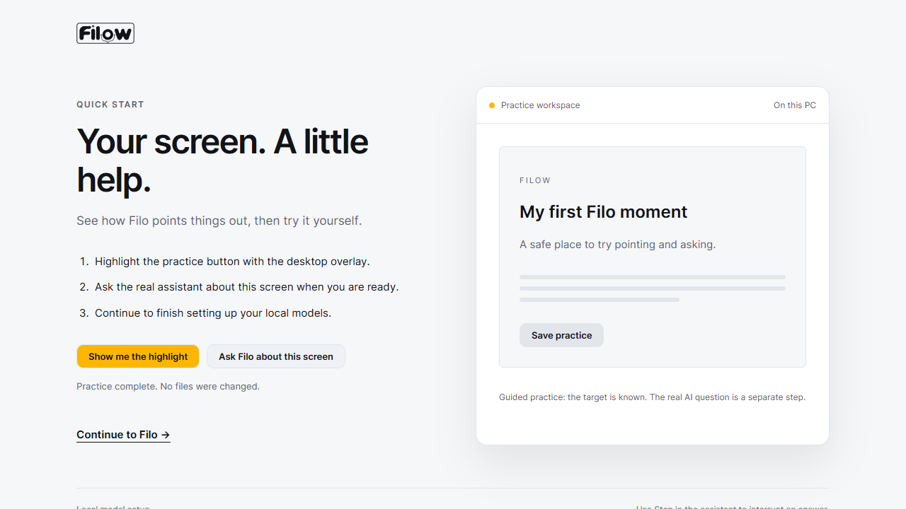
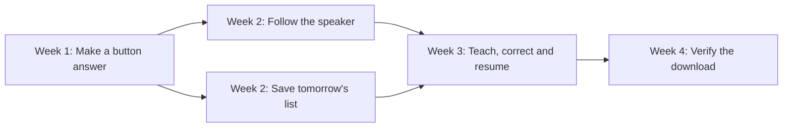

# Start here | Make one button answer you

**Owner,** start with the practice button or jump to the two rehearsal cards below. **Junior developer,** use the practice button to make your first visible change. The first exercise works on the 18 November source. Day-by-day, the permitted stage action and the three factory commands are milestones in the plan.

## First win | Click Save practice

If Filow is already running, open its local web tour at `http://127.0.0.1:4747/tour`. In **Practice workspace**, click **Save practice**. The status says **“Practice complete. No files were changed.”** In Italian, click **Salva prova** and look for **“Prova completata. Nessun file è stato modificato.”** Try the click using Tab and Enter. This button runs locally. The adjacent “Ask Filo about this screen” starts a different, live flow.



The practice ticket asks for a confirmation that tells the user what to do next. Test whether the new wording makes the next step clear.

### Junior | Open your own copy

Use PowerShell on Windows with Git, Node 22 and npm. Start in a writable directory on a volume with room for the clone, dependencies and browser profile. A separate practice clone keeps your changes isolated from the installed app. On a prepared practice checkout, use its existing dependencies.

```powershell
$practiceRoot = Join-Path (Get-Location).Path 'filow-practice'
$lab = Join-Path $practiceRoot 'checkout'
$cache = Join-Path $practiceRoot 'cache'
$env:TEMP = Join-Path $cache 'temp'
$env:TMP = $env:TEMP
$env:npm_config_cache = Join-Path $cache 'npm'
$env:XDG_CACHE_HOME = $cache
$env:NEXT_TELEMETRY_DISABLED = '1'
New-Item -ItemType Directory -Force -Path $env:TEMP | Out-Null
git --version
node --version
npm.cmd --version
```

Look for a Node version starting with `v22.`. For a new practice copy run the next block once. If the checkout already exists, continue there.

```powershell
git clone https://github.com/stefandsl/filow.git $lab
if ($LASTEXITCODE -ne 0) { throw 'Clone failed. Check the destination and network connection.' }
Set-Location $lab
git switch --detach 368f019
if ($LASTEXITCODE -ne 0) { throw 'The lesson commit is missing.' }
git switch -c practice/tour-copy
npm.cmd ci --ignore-scripts --no-audit --no-fund
if ($LASTEXITCODE -ne 0) { throw 'Dependency setup failed. Read the first npm error.' }
```

Start the web tour in this terminal. Keep it open. Port 4799 lets the installed app keep its usual port.

```powershell
Set-Location (Join-Path $lab 'apps\web')
& '..\..\node_modules\.bin\next.cmd' dev --hostname 127.0.0.1 --port 4799
```

Wait for **Ready**, then open `http://127.0.0.1:4799/tour` in a test browser. For a separate Edge test profile, open a second PowerShell window in the same starting directory and repeat the first setup block to define `$lab` and `$cache`. Then run the following commands.

```powershell
$edge = Join-Path ${env:ProgramFiles(x86)} 'Microsoft\Edge\Application\msedge.exe'
& $edge "--user-data-dir=$(Join-Path $cache 'edge')" '--no-first-run' 'http://127.0.0.1:4799/tour'
```

Click **Save practice** and read the status. If your practice tour opens in another language, visit `http://127.0.0.1:4799/`, choose English in the language selector, then return to `/tour`. In the second terminal, open the English dictionary from the practice clone.

```powershell
Set-Location $lab
Select-String -Path 'packages\core\src\i18n\en.ts' -Pattern '"tour.saved"'
notepad.exe 'packages\core\src\i18n\en.ts'
```

Change only the English value for `tour.saved` to **Practice complete. Choose Continue to finish setup.** Save. Refresh the practice page and click **Save practice** again. The button now answers with your sentence. Press Tab until **Continue to Filo** has focus. You just tested the instruction you wrote. Compare the two lines in your terminal:

```powershell
git diff -- packages/core/src/i18n/en.ts
```

The removed line starts with a minus. The new line starts with a plus. Keep the experiment in this practice copy. Product copy changes follow the normal language and review checks. Use **Ctrl+C** in the server terminal when finished. [Tour component](../apps/web/app/tour/page.tsx) · [English dictionary](../packages/core/src/i18n/en.ts)

## Use the three commands when N-08 lands

A run receipt is a **luggage tag**. It tells the next person which ticket, worktree, commit and result belong together. Run the preflight from the root of a clean clone containing the N-08 scripts. List the scripts with `npm.cmd run`. At the November baseline the manual button exercise above works without them.

### Clean-clone preflight

Confirm that `npm.cmd run` lists `filow:plan`, `filow:build` and `filow:verify`. Set up the providers required by your factory configuration through their supported sign-in or credential setup. The launcher checks readiness in memory and reports a pass or the missing prerequisite without displaying secrets.

### Practice ticket N-08-PRACTICE

From a practice copy, change the English Save practice confirmation to **Practice complete. Choose Continue to finish setup.** A click must show the new sentence and leave files untouched. Reloading before a click must leave the status empty. Use the local `/tour` page and the synthetic practice workspace. Keep the change in the isolated practice worktree.

```powershell
npm.cmd run filow:plan -- N-08-PRACTICE
npm.cmd run filow:build -- N-08-PRACTICE
npm.cmd run filow:verify -- N-08-PRACTICE
```

1. **Plan.** Read the first card. It should name the button, the expected sentence and the empty status before the click.
2. **Build.** Look for the run ID, the isolated worktree, the first failing check and the green result on the changed version. Stop at a saved step. In a fresh session repeat the build line. It should reopen the same worktree. If two runs are listed, use the saved run ID in place of `N-08-PRACTICE`.
3. **Verify.** A fresh reviewer tries the click and the reload. Check the new sentence, empty initial status and absence of file writes. Look for **PASS** or **HOLD** and the evidence path. An owner release has its own receipt and public URL. [Command contracts](METHODOLOGY.md#three-commands)

## Owner | Try the package at your desk and on stage

Use the N-07 package identified by its hash. These cards describe the candidate you will receive. For a downloaded Windows installer, run this in the directory containing that version's installer and compare the SHA512 with its receipt:

```powershell
Get-FileHash -Algorithm SHA512 -Path '.\Filow-*-win-x64.exe'
```

**Stage card.** Choose your nearby or Bluetooth mic. Pair the phone on the LAN. Start the three-point water-cycle lesson. Digress, ask for the cloud photo and diagram, then ask Filow to open the named lesson site. Decline once and check that the site stays closed. Ask again and approve. Let Filow explain the cooling control. Change it yourself. Ask a learner what would happen on a cold window. Stop Filow and continue your third point. Look for agreement on both screens. Save the version, mic, expected point and what the learner said.

**Daily card.** Open Day-by-day. Tap Talk and dictate two non-sensitive tasks due tomorrow. Tell Filow that one is done using different words. Check that exactly one ticks. Correct yourself, try Undo, and use Tab and Enter once. Close the app. Open it the next morning and find the unfinished task. Say the same sentence during a call and confirm zero edits. Keep a separate verdict for this card even if the lesson is still waiting for a device.

Record each result in this form:

```text
Package version and SHA512 | Device and mic | Stage or Daily | PASS or HOLD
What I did | What I saw | What I expected | Next check if held
```

## Four weeks of small wins

Weeks are practice targets. Each arrow means that evidence is ready for the next exercise. The owner can use either passing private route straight away.



| Week | Junior's small win | Owner's small win | Keep this evidence |
|---|---|---|---|
| 1 | Change the tour message and reach Continue by keyboard. | Click the original practice button and choose one lesson and two daily tasks. | One before/after pair and the two rehearsal cards. |
| 2 | Show a saved talk point after mic loss and a daily task after restart. | Try each available Windows route on your own mic. Take home any passing private build. | One package hash and a separate result for each route tested. |
| 3 | Resume an interrupted build. Ask a different vendor to challenge a consequential change. | Approve the lesson site, refuse it on replay, and find yesterday's unfinished task. | A learner's answer, a day-two observation and the review receipt. |
| 4 | Exercise recall on a disposable feed and verify the higher fixed version preserves data. | Compare the candidate's trust and upgrade evidence. Promote only when the public gate passes. | A source push SHA and, when live, the tested installer URL and digest. |

## If something looks wrong

| What you see | Try this | What should happen |
|---|---|---|
| `npm.ps1` is blocked or a command is missing | Use `npm.cmd` in PowerShell. Check Node 22 and run from the correct clone. If the missing script is a factory verb, check N-08 first. | Existing npm scripts list successfully. |
| Factory credential preflight fails | Resolve the missing prerequisite through the configured provider’s supported setup, then rerun the preflight. | The launcher reports readiness without exposing values. |
| The tour won't open, or the old wording returns | Check the server says Ready. Open port 4799, choose English and click Save practice again. If 4799 is busy, substitute 4800 in the server and browser commands. | The new sentence appears in the practice copy. |
| The browser asks for the desktop to draw a highlight | Click Save practice for this exercise. Use the installed desktop for its overlay test. | Local practice changes the status without an AI call. |
| The class is quiet on screen, or the list changes in a call | Check mode, mic permission, active input and mute. Type the same phrase. Record the mode, device and wrong effect. | Typed input distinguishes a mic problem from a decision problem. A wrong-mode tick earns HOLD. |
| Build stopped halfway or a lock is busy | Repeat the same verb with its run ID. Follow the saved diagnostic. Preserve the worktree and existing lock while the listed process is alive. | One run resumes or reports the exact conflict. |
| Source is pushed, but you cannot find the new installer | Compare the feed version with the owner release receipt. | Until promotion and readback pass, v0.9.42 is the last confirmed public download in this report. [Public feed](https://github.com/stefandsl/filow-releases/releases/latest) |
