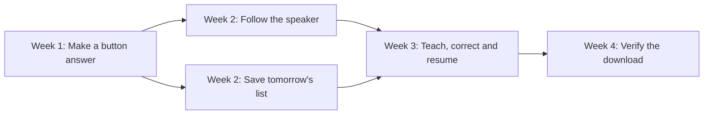

# Start here | Make one button answer you

**Owner,** start with the practice button or jump to the two rehearsal cards below. **Junior developer,** use the practice button to make your first visible change. The first exercise works on the 18 November source. The factory walkthrough below starts from a clean linked worktree.

## First win | Click Save practice

If Filow is already running, open its local web tour at `http://127.0.0.1:4747/tour`. In **Practice workspace**, click **Save practice**. The status says **“Practice complete. No files were changed.”** In Italian, click **Salva prova** and look for **“Prova completata. Nessun file è stato modificato.”** Try the click using Tab and Enter. This button runs locally. The adjacent “Ask Filo about this screen” starts a different, live flow.


The practice ticket asks for a confirmation that tells the user what to do next. Test whether the new wording makes the next step clear.

### Junior | Open your own copy

Use PowerShell, Git and Node 22. Choose a writable project volume outside C: with at least 20 GB free. Start in its project directory. The practice uses the revision containing these commands. The historical manual tour exercise starts at `368f019`.

```powershell
$practiceRoot = Join-Path (Get-Location).Path 'filow-practice'
$lab = Join-Path $practiceRoot 'checkout'
$tree = Join-Path $practiceRoot 'tour worktree'
$cache = Join-Path $practiceRoot 'cache'
$env:TEMP = Join-Path $cache 'temp'
$env:TMP = $env:TEMP
$env:npm_config_cache = Join-Path $cache 'npm'
$env:electron_config_cache = Join-Path $cache 'electron'
$env:ELECTRON_CACHE = $env:electron_config_cache
$env:XDG_CACHE_HOME = $cache
$env:NEXT_TELEMETRY_DISABLED = '1'
New-Item -ItemType Directory -Force -Path $env:TEMP | Out-Null
git --version
node --version
npm.cmd --version
git clone https://github.com/stefandsl/filow.git $lab
if ($LASTEXITCODE) { throw 'Clone failed. Check the destination and connection.' }
git -C $lab worktree add -b practice/tour-copy $tree HEAD
if ($LASTEXITCODE) { throw 'Use the existing assigned practice worktree or choose an unused branch.' }
Set-Location $tree
npm.cmd ci --prefer-offline
if ($LASTEXITCODE) { throw 'Dependency setup failed. Read the first npm error.' }
npm.cmd run
```

Look for all three factory verbs. Always invoke them from the root of the linked ticket worktree. For another run on the same ticket use another clean linked branch. If several runs match, copy the exact run ID from the list.

### Practice ticket N-08-PRACTICE

A junior opens the synthetic English tour, clicks **Save practice** and sees **Practice complete. Choose Continue to finish setup.** The click writes zero practice data. Reload clears the live status. The baseline displays a privacy hint inside the status before the first click. Keep the hint visible when you move it outside the live confirmation. The fixture names both writable files. [Practice card](../tools/factory/N-08-PRACTICE.json)

Start with an offline rehearsal. Each invocation opens the same private rehearsal. It writes a brief and a receipt, leaves the checkout clean and spends nothing.

```powershell
npm.cmd run filow:plan -- N-08-PRACTICE --dry-run
npm.cmd run filow:build -- N-08-PRACTICE --dry-run
npm.cmd run filow:verify -- N-08-PRACTICE --dry-run
```

**Plan.** For live work, use a provider account approved for this ticket and its spend. The runner checks the current process for `CODEX_API_KEY` or `OPENAI_API_KEY` for Codex and `ANTHROPIC_API_KEY` for a consequential review. Load them through your provider credential setup. The printed status describes configuration. Authentication and availability are established by the actual assignment. Keep credentials out of command arguments and files.

```powershell
npm.cmd run filow:plan -- N-08-PRACTICE
npm.cmd run filow:build -- N-08-PRACTICE
```

Copy the run ID and state path. The first build saves the edit intent, writes the builder brief and prints the desktop Codex command. Run the printed `powershell.exe ... dispatch.ps1` line for an approved dispatch. It starts Codex with a private profile and only its own provider credential. You can close the terminal at this point and repeat the same build command in another one. When a credential is missing, restore it in the new terminal and repeat the saved command.

**Make and observe the edit.** Start the tour on the assigned checkout in a second terminal. Replace the path below with the worktree path printed by plan. Use an unused port, for example 4799 or 4800.

```powershell
Set-Location 'G:\your-projects\filow-practice\tour worktree\apps\web'
& '..\..\node_modules\.bin\next.cmd' dev --hostname 127.0.0.1 --port 4799
```

Wait for **Ready**. Open `http://127.0.0.1:4799/tour` in a test browser. For an isolated Edge profile run the following in the setup terminal.

```powershell
$edge = Join-Path ${env:ProgramFiles(x86)} 'Microsoft\Edge\Application\msedge.exe'
& $edge "--user-data-dir=$(Join-Path $cache 'edge')" '--no-first-run' 'http://127.0.0.1:4799/tour'
```

Choose English at `/` if needed, then return to `/tour`. Check the click before and after the change in dark and light themes. The new English `tour.saved` value belongs in `packages/core/src/i18n/en.ts`. The initial live region belongs to the tour component. Reach Save and Continue with Tab and Enter, reload, and inspect network and storage for practice writes. Record the serving path, port, commit and observations. Stop your server with Ctrl+C. The builder report must name the real provider, model, effort and session, base observation, candidate observation and full candidate commit. Each green commit carries the ticket prefix, its reason and the printed `Factory-Run` trailer. [Tour component](../apps/web/app/tour/page.tsx) · [English dictionary](../packages/core/src/i18n/en.ts)

**Resume and verify.** In a fresh PowerShell session open the same clean worktree. Restore the environment from setup. Run build with the saved ID. It inspects the actual commits, runs the desktop preparation and gates and prints the changed files and candidate. Keep unexplained files and commits for inspection.

```powershell
$run = 'run-REPLACE-WITH-YOUR-ID'
npm.cmd run filow:build -- $run
if ($LASTEXITCODE) { throw 'Read the HOLD and resume instruction.' }
$sha = git rev-parse HEAD
npm.cmd run filow:verify -- $run --candidate $sha
```

Verify saves **HOLD** while a packet awaits a reply. Give the blind packet alone to a fresh reviewer in the indicated folder. Save its distinct case as the requested JSON. Repeat the same verify line to obtain a read-only replay packet, then the independent judge packet. Use a fresh session at each step and the provider named in the brief. The judge receives the replay evidence. Each packet includes the output path and exact fields. A completed run prints **Local PASS** and its evidence path. A red gate stops immediately. Correct the documented cause before using `--retry` once. An unresolved review gets another dispatch only with `--new-round`, within the shared three-round limit.

Record elapsed time, people who helped, commit count before and after repeating build, and the state path. Release is the owner's separate fourth action. [Factory rules](METHODOLOGY.md)

For another plan ticket use its ID or quote its title or request. Supply a scoped JSON `--card` with the practice card's fields to freeze exact examples, callers and writable paths. Plan can prepare a coordinator brief for an existing ticket that lacks a card. Keep the filled card private. Private state lives in `.filow-factory` beside the primary clone, grouped by repository, live or rehearsal, and run ID. Only the runner writes `run.json`.


## Owner | Try the package at your desk and on stage

Use the N-07 package identified by its hash. These cards describe the candidate you will receive. For a downloaded Windows installer, run this in the directory containing that version's installer and compare the SHA512 with its receipt:

```powershell
Get-FileHash -Algorithm SHA512 -Path '.\Filow-*-win-x64.exe'
```

**Stage card.** Choose your nearby or Bluetooth mic. Pair the phone on the LAN. Start the three-point water-cycle lesson. Digress, ask for the cloud photo and diagram, then ask Filow to open the named lesson site. Decline once and check that the site stays closed. Ask again and approve. Let Filow explain the cooling control. Change it yourself. Ask a learner what would happen on a cold window. Stop Filow and continue your third point. Look for agreement on both screens. Save the version, mic, expected point and what the learner said.

**Daily card.** Open Day-by-day. Tap Talk and dictate two non-sensitive tasks due tomorrow. Tell Filow that one is done using different words. Check that exactly one ticks. Correct yourself, try Undo, and use Tab and Enter once. Close the app. Open it the next morning and find the unfinished task. Say the same sentence during a call and confirm zero edits. Keep a separate verdict for this card even if the lesson is still waiting for a device.

Record each result in this form:

```text
Package version and SHA512 | Device and mic | Stage or Daily | PASS or HOLD
What I did | What I saw | What I expected | Next check if held
```

## Four weeks of small wins

Weeks are practice targets. Each arrow means that evidence is ready for the next exercise. The owner can use either passing private route straight away.



| Week | Junior's small win | Owner's small win | Keep this evidence |
|---|---|---|---|
| 1 | Change the tour message and reach Continue by keyboard. | Click the original practice button and choose one lesson and two daily tasks. | One before/after pair and the two rehearsal cards. |
| 2 | Show a saved talk point after mic loss and a daily task after restart. | Try each available Windows route on your own mic. Take home any passing private build. | One package hash and a separate result for each route tested. |
| 3 | Resume an interrupted build. Ask a different vendor to challenge a consequential change. | Approve the lesson site, refuse it on replay, and find yesterday's unfinished task. | A learner's answer, a day-two observation and the review receipt. |
| 4 | Exercise recall on a disposable feed and verify the higher fixed version preserves data. | Compare the candidate's trust and upgrade evidence. Promote only when the public gate passes. | A source push SHA and, when live, the tested installer URL and digest. |

## If something looks wrong

| What you see | Try this | What should happen |
|---|---|---|
| `npm.ps1` is blocked or a command is missing | Use `npm.cmd` in PowerShell. Check Node 22 and run from the correct clone. If the missing script is a factory verb, check N-08 first. | Existing npm scripts list successfully. |
| Factory credential preflight fails | Resolve the missing prerequisite through the configured provider’s supported setup, then rerun the preflight. | The launcher reports readiness without exposing values. |
| The tour won't open, or the old wording returns | Check the server says Ready. Open port 4799, choose English and click Save practice again. If 4799 is busy, substitute 4800 in the server and browser commands. | The new sentence appears in the practice copy. |
| The browser asks for the desktop to draw a highlight | Click Save practice for this exercise. Use the installed desktop for its overlay test. | Local practice changes the status without an AI call. |
| The class is quiet on screen, or the list changes in a call | Check mode, mic permission, active input and mute. Type the same phrase. Record the mode, device and wrong effect. | Typed input distinguishes a mic problem from a decision problem. A wrong-mode tick earns HOLD. |
| Build stopped halfway or a lock is busy | Repeat the same verb with its run ID. Follow the saved diagnostic. Preserve the worktree and existing lock while the listed process is alive. | One run resumes or reports the exact conflict. |
| Source is pushed, but you cannot find the new installer | Compare the feed version with the owner release receipt. | Until promotion and readback pass, v0.9.42 is the last confirmed public download in this report. [Public feed](https://github.com/stefandsl/filow-releases/releases/latest) |
